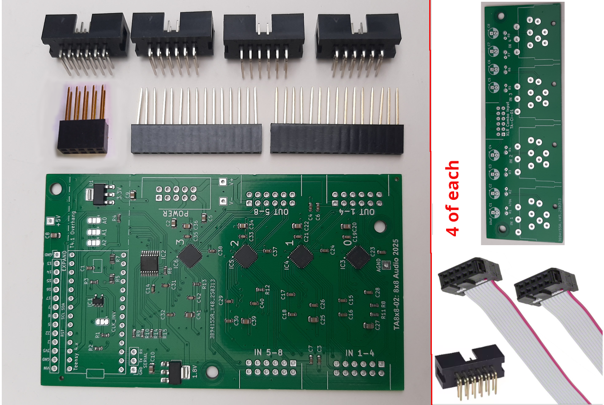

# Teensy Audio TLV320AIC3104 8x8 CODEC Board Kit

A 8x8 channel CODEC board kit for connection to a Teensy microcontroller board.

On the main PCB, the electronic components are fully mounted, with the connectors supplied un-mounted.

The kit also contains four wing boards without components. One of five connectors is supplied, un-mounted.

Four IDC cables are also supplied.

